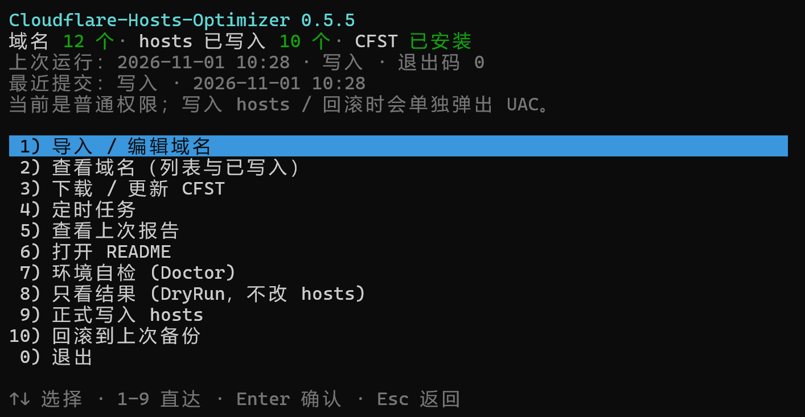
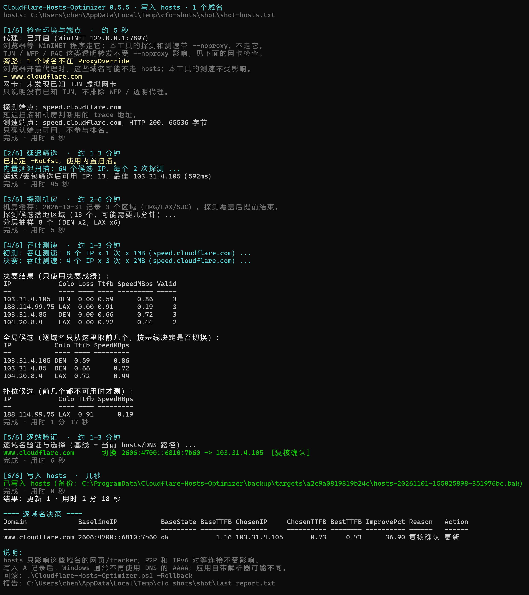

# Cloudflare-Hosts-Optimizer

Pick the fastest Cloudflare edge IPs and safely write them into the Windows hosts file, so any
Cloudflare-proxied site (PT forums, etc.) loads faster.

> No proxy, no login, no egress IP change. Strict hosts validation, incremental updates,
> one-click rollback.

Windows 10/11 · PowerShell 7+ · built-in `curl.exe` · CFST optional

[中文说明](README.md) · [Releases](https://github.com/chenfangshuo/Cloudflare-Hosts-Optimizer/releases)

**Why this exists.** Most PT sites on my line took over ten seconds to open. Picking IPs with
[CloudflareSpeedTest](https://github.com/XIU2/CloudflareSpeedTest) and editing hosts by hand did
help, but two things kept biting: the lowest-ping IP sometimes returned Error 1034 (the site
refuses that IP and the page simply won't load), and CFST's default speed-test URL is no longer
maintained. So this chains the whole thing into one run: latency scan → throughput test →
per-domain verification → hosts write → one-click rollback. **One PT site here went from >10s to
about 3s; a single-site run measured TTFB 1.75s → 0.69s.**

## Quick start (30 seconds)

No commands — download, extract, double-click:



1. **Download and fully extract** the release, enter the inner `Cloudflare-Hosts-Optimizer\`
   folder and **double-click `Start.bat`**. It finds PowerShell 7, or offers to install it with winget.
2. **Press `1` to import / edit domains** (see the next section), then close the editor.
3. **(Optional) Press `3` to download / update CFST**: wider candidate coverage and usually a
   better result; without it the built-in scanner is used, but it can miss good IPs.
4. **(Optional) Press `8` for a dry run**: no hosts changes, just a preview of what would switch.
5. **Press `9` to apply**, confirm the UAC prompt — and press `10` to roll back at any time.

Keys: `↑`/`↓` to move, `1`–`9` jump to the first nine items, item 10 ("roll back") with the arrow
keys, `0` to exit / go back, `Enter` to confirm, `Esc` to go back. The first run takes about
**8–15 minutes** and prints `[n/6] step · estimate` plus a spinner (e.g. `| 96/256 · 45s`); it is
not stuck. Menu details, elevation and the full option list are in
[the guide](docs/guide.md) (Chinese).

Steps 3 and 4 are optional. Note that **a dry run still sends real requests**: running it right
before applying means every site is probed twice — see [the notes](#notes).

## Domains and notes

`domains.txt` takes one domain per line; `#` starts a comment. Three ways to fill it:

- menu `1` → `5 手动编辑 domains.txt` and type them in Notepad, one per line;
- menu `1` to import from a PT-Depiler backup, the Windows proxy bypass list, text or the
  clipboard, then review the result;
- the command line: `.\Import-Domains.ps1 -Source Depiler -Path '.\PTD_backup.zip' -Merge` —
  the four sources and merge rules are in [the guide](docs/guide.md#域名导入与合并) (Chinese).

What to put in: **web hostnames only** — never tracker subdomains like `tracker.example.com` —
and **only sites you have confirmed are proxied by Cloudflare**. A wrong entry does no harm, the
per-domain check just skips it. When unsure, look at the headers:

```powershell
curl.exe -sI https://example.com | findstr /i "server:"
```

`server: cloudflare` is a hint, not proof. Keep uncertain domains in the list and run `-DryRun`.

### Notes

1. The first run takes about **8–15 minutes**; writing hosts needs administrator rights;
   **hosts only affects this machine** and does not change the origin the site sees, nor P2P or
   IPv6 peer connections.
2. Each run sends only a handful of HEAD requests to each site (headers only, no page body):
   typically 6–10, at most 11, at most twice per IP during the pre-switch check, 400ms apart —
   do not raise it. The script **does not log in, send cookies, read passkeys, touch announce
   URLs or connect to tracker ports**; bulk speed tests only hit `speed.cloudflare.com`; **it
   only processes the domains in `domains.txt`** and never crawls or discovers sites.
   **A dry run also sends real requests**: running one right before applying probes every site
   twice, doubling the exposure. If you intend to apply, press `9` directly; if you want a
   preview, run the dry run some other time.
3. **The egress IP does not change**: only the CF edge node changes, and only for domains in your
   proxy bypass list. The script checks the WinINET bypass list and TUN adapters, but cannot fully
   detect PAC/WPAD, WinHTTP, app-level proxies or WFP transparent redirection. Never use VPNs,
   online IP-picking services or public reverse proxies to access PT sites.
4. By default it only adds/updates domains in your list and **does not delete other managed
   entries**; `-Prune` is required to drop mappings that are no longer listed.
5. **Clash can stay on** while the script runs (every curl call uses `--noproxy '*'` and CFST
   clears proxy environment variables); but **for browsing through hosts, turn the proxy off or
   put the domains in the bypass list**. A TUN adapter aborts the run unless you add `-Force`.
6. Picked IPs drift over time — **re-run every 1–2 weeks**, or use a
   [scheduled task](docs/guide.md#定时运行). hosts only changes name resolution; IPv6 is not
   optimised yet.
7. Avoid tracker-only subdomains: an announce is a few dozen bytes every 30 minutes, there is
   nothing to gain, and a stale mapping or an Error 1034 breaks announcements and turns torrents
   red. Same-host setups (`example.com/announce.php`) cannot be separated, so they rely on
   periodic re-runs and rollback. [Why](docs/faq.md#要不要把-tracker-域名加进-domainstxt).

Full rules and the request budget: [design notes](docs/design.md#安全与请求预算) (Chinese).

## What a run looks like

A single-site run measured TTFB 1.75s → 0.69s (−60%). Below is one complete run (demo data,
domains replaced), from the environment check through latency screening, colo sampling,
throughput and per-domain verification to the hosts write and final decision table:



How the choice is made, how 1034 falls back to DNS, and how hosts writes stay reversible:
[design notes](docs/design.md) (Chinese).

## Command line & automation

Same features from a terminal (short form; the real invocation is
`pwsh -File .\Cloudflare-Hosts-Optimizer.ps1 ...`):

```powershell
.\Cloudflare-Hosts-Optimizer.ps1 -DryRun      # scan and verify, no hosts changes
.\Cloudflare-Hosts-Optimizer.ps1              # apply (elevated)
.\Cloudflare-Hosts-Optimizer.ps1 -Rollback    # restore the latest backup
.\Cloudflare-Hosts-Optimizer.ps1 -Doctor      # read-only self-check
```

For automation, `-Plan -PlanPath .\plan.json` emits a JSON plan without touching hosts; schedule a
recurring run with `-InstallTask -TaskMode DryRun` (AutoApply needs admin). Every option,
scheduled-task detail and import command: [the guide](docs/guide.md) (Chinese).

## Docs & credits

| Document | When to read it |
| --- | --- |
| [docs/guide.md](docs/guide.md) | Menu details, domain import, CFST download, scheduled tasks, all options, data locations |
| [docs/design.md](docs/design.md) | The five selection stages, CFST comparison, 1034 handling, hosts transaction and rollback rules |
| [docs/faq.md](docs/faq.md) | Startup troubleshooting, ban boundaries, error meanings, uninstall |

Development: `Invoke-Pester -Path .\tests` (fully offline, never touches the real hosts file).
See [CONTRIBUTING.md](CONTRIBUTING.md) (includes the release process); report security issues
through [SECURITY.md](SECURITY.md), not a public issue.

Credits: [XIU2/CloudflareSpeedTest](https://github.com/XIU2/CloudflareSpeedTest) (the screening
engine, GPL-3.0, not bundled), [PT-Depiler](https://github.com/pt-plugins/PT-depiler) (backup
schema reference), [cmliu/CF-Workers-SpeedTestURL](https://github.com/cmliu/CF-Workers-SpeedTestURL)
(self-hosted speed-test URL).

License: [MIT](LICENSE). This repository does not include CloudflareSpeedTest code or binaries.
