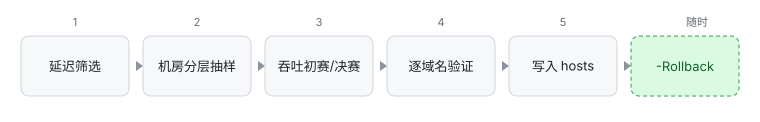

# 工作原理与安全机制

这份文档回答"它凭什么这么选、凭什么敢改 hosts"。操作步骤见 [guide.md](guide.md)，
具体报错和"我该怎么办"见 [faq.md](faq.md)。

<picture>
  <source media="(prefers-color-scheme: dark)" srcset="images/pipeline-dark.svg">
  
</picture>

## 目标

不是"找出延迟最低的 CF IP"，而是"找出对这些域名实际最快、且确实能用的边缘 IP"，
并且以可回滚、不破坏 hosts 其他内容的方式落地。

## 处理流程

1. **延迟/丢包筛选**：有 `cfst.exe` 时用 `cfst -dd -tlr 0.05` 只做延迟/丢包；没有时用内置
   扫描，从官方 IPv4 段随机抽样，用 `speed.cloudflare.com/cdn-cgi/trace` 探测。只保留
   丢包率 ≤5%、有响应的 IP，按延迟升序。CFST 的输出写在本次运行独立的临时目录，不覆盖
   用户已有的 `result.csv`；数字用 `InvariantCulture` 解析，并校验丢包/延迟范围和 IP 是否
   属于允许网段。
2. **机房探测与分层抽样**：取延迟最低的 256 个候选逐个读 `colo=`，按机房分组、组内按 TTFB
   排序，再轮流取样 32 个。避免纯延迟排序把候选全选成 HKG。
3. **吞吐初测**：32 个候选各下 1MB。有效样本必须同时满足：curl 退出码 0、HTTP 200/206、
   ≥95% 字节、`time_total > 0`、`remote_ip` 等于候选 IP、不跟随重定向。初测只用于晋级。
4. **决赛**：初测前 6 名跑 3 × 2MB，**串行**（避免互相抢本机带宽）。有效样本 ≥2 才参与
   排名，取真中位数；决赛失败的 IP 直接淘汰，不保留初测分数。最终排名只认决赛。
5. **逐域名选择（基线对比）**：见下面的设计决策。每域名最多 `-TopN` 个 IP（默认 1），
   多 IP 时额外 IP 需与主 IP 同类且 TTFB 不超过主 IP 的 1.5 倍。
6. **写入 hosts**：读取并严格解析；任何结构/编码/冲突问题直接中止。增量合并后走
   备份 → 临时文件 → 原子替换 → 读回校验 → 刷新 DNS。

## 关键设计决策

### 为什么 CFST 只做延迟，不做下载测速

CFST 的下载测速结果高度依赖 `-url` 指向的文件，而这个默认地址本身就不稳定：

- 默认地址 `https://cf.xiu2.xyz/url` 已改为重定向到公益地址，不保证可用
  （[issue #168](https://github.com/XIU2/CloudflareSpeedTest/issues/168)）；2026-10-29
  实测直接返回 **403**。当前版本（v2.3.5）对非 200 响应直接判失败，所有 IP 都是 0 MB/s，
  等于测不出东西。
- 历史上还出现过测速虚高的 bug（[issue #290](https://github.com/XIU2/CloudflareSpeedTest/issues/290)），
  社区也常有"速度超过线路带宽"的报告
  （[issue #251](https://github.com/XIU2/CloudflareSpeedTest/issues/251)）——单端点、
  单次采样很容易被小文件、缓存或异常响应带偏。

结论是通用的：**不要把单一测速端点的结果当成真实吞吐**。本工具只用 CFST 的延迟/丢包
（`-dd`），吞吐自己测，并校验退出码、HTTP 200/206、≥95% 字节、远端 IP 和重定向。

### CFST 与内置扫描

`cfst\` 里有 `cfst.exe` 时优先用 CFST；没有、运行失败或指定 `-NoCfst` 时用内置扫描。
两者**共用**后面的机房分层、吞吐决赛和逐域名基线选择，区别只在候选池和延迟测量方式。

| | 有 cfst.exe（默认优先） | 内置扫描（`-NoCfst` / 未找到） |
| --- | --- | --- |
| 候选来源 | `cfst\ip.txt`：当前 25 个网段 | 从官方网段随机抽 `-MaxCandidates` 个（默认 192） |
| 延迟测量 | TCPing（TCP RTT） | HTTPS `cdn-cgi/trace`（含 TLS，接近网页 TTFB） |
| 覆盖 | 通常更容易找到低延迟、低丢包的 IP | 抽样有限，可能漏掉好 IP |
| 速度 | CFST 内部多线程，扫描快 | 192 × 2 次 curl，通常几十秒 |
| 依赖 | 第三方 GPL-3.0 二进制，需自行下载 | 仅 PowerShell 7 + 系统 `curl.exe` |
| 相关参数 | `-CfstPath` | `-MaxCandidates`、`-ScanSamples`、`-NoCfst` |

- 两者都只做**延迟/丢包预筛**；最终选哪个 IP 由吞吐决赛 + 逐域名基线决定，下载测速都不用。
- 两条路径都只允许 CF 官方网段；`104.28.0.0/14` 需要 `-ExperimentalRanges`
  （CFST 的 `ip.txt` 虽包含它，也会被过滤）。
- **两套网段并不完全一致**：本机这份 `ip.txt` 的 172.64 段只覆盖 172.64–172.67，内置的
  `172.64.0.0/13` 还包含 172.68–172.71；`ip.txt` 具体有哪些网段取决于你下载的 CFST 版本。
  `-Doctor` 会算出两者的 /24 覆盖差异。
- CFST 找不到或运行失败会自动回退，不会中断。批量扫描只打 Cloudflare 公共端点。

### 端点预检与主备

每次运行在扫描前先确认两个端点：

- **探测端点**（`-ProbeUrl`，默认 `https://speed.cloudflare.com/cdn-cgi/trace`）：内置扫描
  和机房探测都靠它的 `colo=` 判断落地区域，所以要求响应里必须有 `colo=`。默认端点不可用时
  自动退到 `https://cloudflare.com/cdn-cgi/trace` 并告警；显式指定 `-ProbeUrl` 时不回退
  ——否则测的已经不是用户指定的目标。自定义地址必须是 Cloudflare 托管域名
  （`--resolve` 只替换 DNS，TLS 证书仍按域名校验）。
- **测速端点**（`-SpeedTestUrl`）：请求 64KB，按正式样本的同一套规则判定。它只证明端点活着，
  不参与排名；没有 `{bytes}` 占位符的地址无法指定字节数，预检会跳过并告警。

为什么吞吐端点不做主备切换：没有可靠的公开替代地址，而且同一轮里换地址会让不同 IP 的
速度不可比。失败时直接中止，并提示换 `-SpeedTestUrl`。

代价是每次多一次 trace 和一次 64KB 请求（约 1–2 秒），换来不必扫三分钟才发现测不到速度。
`-Doctor` 用同样的函数检查这两个端点。

### 为什么按机房分层

同一线路到不同 CF 机房的表现差异很大：

- HKG：TCP 握手可能只有 130ms，但大流量丢包、TLS 偶发数秒、3MB 下载可能超时。
- LAX/SJC：握手 170–340ms，吞吐不一定最好，但通常更稳定。
- FRA/LHR 等：有时吞吐反而更高，但网页 TTFB 不一定更好。

只按延迟排序会系统性地高估 HKG。分层抽样保证每个主要机房都有候选，再由吞吐和逐站 TTFB 决定。

探测 256 个候选的落地区域要几分钟，而同一线路能落到的机房在几周内基本稳定，所以工具会缓存
上一次观察到的机房集合（默认 14 天）：

- 每探测 32 个检查一次，覆盖了缓存里的机房就提前结束（通常 64–96 个就够）；
- 缓存里的机房没有重新出现（路由变了）时，覆盖检查失败，自动退回全量探测；
- 只有完整探测过一轮、且候选池不少于 64 个才更新缓存：提前结束看到的是子集，小池子
  （如 `-MaxCandidates 24`）本身就快，写回反而会把缓存越缩越窄；
- 只缓存抽样里出现 ≥2 次的区域，最多 6 个。稀有区域下次经常消失，留在缓存里会让覆盖检查
  永远失败，加速效果直接归零。

缓存只是加速，测速、逐站验证和写入判定的规则完全不变。`-NoColoCache` 强制每次全量探测。

### 为什么逐域名验证

同一个 CF 边缘 IP 能服务任何 CF 站点，但站点本身可能：不是 Cloudflare 托管、DNS 被污染、
正在维护或被 WAF 拦截、对 HEAD 请求直接断开。逐站验证是最后一道保险；验证失败时保留可用
旧映射，不会把原本能用的站弄挂。这是"尽力而为"，不是"非 CF 一定能识别"。

验证只发 HEAD；可接受的状态码是一个白名单（200/204/301/302/303/307/308/401/403 等），
不是"所有 2xx/3xx"。每次返回 403/503 的 HEAD 都可能再补 1 次小 GET
（`Range` + `--max-filesize 65536`，只读前 16KB）识别 **1034/1003**——这是"每次 HEAD 一条"
的预算单位，不是整域名只补一次。识别不了就判为不可用，宁可少切换。

### 为什么逐域名选择（基线对比）

- 同一个全局 IP 可能对 A 站可用、对 B 站返回 1034；不同站点到不同机房的 TTFB 也不同。
  所以全局吞吐排名只用于挑前 K 个候选（`-CandidatesPerDomain`，默认 3），最终由每个域名
  独立选择。
- 基线 = 该域名当前的 hosts/DNS 路径。只有候选比基线快 ≥ `-MinImprovementPct`（默认 15%）
  **且**绝对改善 ≥ `-MinImprovementMs`（默认 30ms），或基线失败/类别更差时才切换；快基线下
  15% 可能只有十几毫秒，绝对门槛用来挡住噪声。判定用**未舍入**的数值（14.96% 不会因为
  四舍五入变成 15.0），并留极小的浮点容差，让恰好 15%/30ms 不被误拒。
- 准备切换且**基线首次可用**时，**切换前复核**：基线与选中的那个候选各复测一次并取中位数，
  只在这两者之间比较，不在全部候选里重选；候选复测失败/受限则不切换。基线首次就失败时
  不走复核（直接按"基线不可用"处理）。
- 如果复核时系统解析换了 IP（解析到候选、第三个地址或 IPv6），两个不同 IP 的样本不能合并
  成同一条基线，本次**不切换**，保留 DNS。这也是每域名每 IP 最多 2 次 HEAD 的来源。
- 所有时间字段都扣掉 `time_namelookup`：候选走 `--resolve`（解析≈0），基线走系统解析；
  不扣掉的话基线会白背一次 DNS 时间，门槛会被解析时间吃掉。
- 基线或候选出现 1034 且没有可用候选时，再解析该域名自己的 DNS A 记录（`-NoHostsFile`，
  最多 2 条，仅接受 IPv4 且在允许的 CF 网段内）。
- 旧映射：只有明确 1034/1003 才自动丢弃；连接失败默认保留并告警，`-DropUnreachable` 才删除。

### 为什么 DNS 回退赢了也不写 hosts

1034（Edge IP Validation）表示这个 zone 只服务它自己的 IP（BYOIP、专属/静态 IP、SaaS 接入
等），本质上无法优选。这时 DNS 回退找到的 IP 只是"当前"可用；写进 hosts 会在站点换 IP 后
变成故障源，而且下次运行只会被当成连接失败继续保留。所以胜出的候选来自 DNS 时，动作是
**交还 DNS**（删除该域名的托管条目），让系统解析始终拿到最新地址。BYOIP 地址不在 CF 公共
网段里，会被过滤掉，这种情况下通常连 DNS 回退都没有——结果同样是交还 DNS。

工具只删除自己托管区块里的条目。区块外还有该域名的旧条目时（早先被注释的原条目会恢复，
用户手工行会保留），它们仍会生效，运行结束时会告警；需要真正交还 DNS 请手动删除或注释。

### 为什么写 A 记录会让浏览器走 IPv4

在 Windows 上，hosts 里存在的 A 记录通常会让系统解析器不再从 DNS 返回该名字的 AAAA，
因此浏览器会使用 hosts 里的 IPv4。但这不是绝对的：应用自带解析器、DoH、缓存等可能有
不同行为，`-CheckResolved` 可以查看系统实际返回的地址。这只影响这些域名的网页；
BitTorrent 的 IPv6 对等连接不受影响；tracker 专用子域名建议不写进列表
（见 [FAQ](faq.md#要不要把-tracker-域名加进-domainstxt)）。

### 为什么默认不做 IPv6 优选

在测试线路上，CF 的 IPv6 全部落到 LAX，3MB 下载 15 秒只收到 1.25MB（约 83KB/s），
明显差于 IPv4 候选。脚本目前只扫描 IPv4。

## hosts 写入与安全规则

原则：**能明确判断才改，判断不了就中止**。

### 标记与编码

- 只接受"没有标记"或"恰好一对 BEGIN/END 且顺序正确"。缺 END、重复 BEGIN/END、嵌套、
  孤立 END → 中止并报告行号。
- 区块固定放在文件末尾，前后空行会规范化；其他行保持原样。
- 只支持 ASCII / UTF-8（含 BOM）。UTF-16、GBK/ANSI → 拒绝改写，避免损坏原文件。
- 受管域名在区块外的旧条目改成 `# [Cloudflare-Hosts-Optimizer] <原内容>`，不删除；
  域名不再受管时再还原成未注释状态。

### 冲突检查

- **多别名行**：托管区块外，某行包含受管域名且有多个主机名 → 中止，要求人工拆分。
- **IPv6 映射**：受管域名已有 IPv6 条目 → 中止，避免"写了 IPv4 却仍走 IPv6"。
- **其他工具区块**：检测到 `# XXX BEGIN ... / # XXX END ...` 且其中包含受管域名 → 中止，
  不接管其他工具的条目。

### 增量语义

- 验证成功 → 更新映射。
- 验证失败 → 默认保留上一次映射；只有明确 `1034/1003` 才自动丢弃。
- 连接失败/TLS/超时默认保留并告警，`-DropUnreachable` 才删除。
- 不在本次域名列表 → 默认保留，`-Prune` 才删除。
- 1034 回退胜出的是该域名自己的 DNS 记录时，动作是 **release**：删除托管条目、交还 DNS；
  区块外已有的旧条目/手工条目不会删除，仍会生效并告警。

### 备份与清单

- **系统 hosts**：备份只放在 `%ProgramData%\Cloudflare-Hosts-Optimizer\backup`。
  应用根和备份目录必须是管理员/SYSTEM 独占写；创建时设成"管理员/系统可写、
  普通用户只读"。目录不可用或不可信时**直接中止写入**，不回退到项目目录。
- **沙箱 `-HostsPath`**：只用项目目录下的 `backup\targets\<路径哈希>`，不碰 ProgramData；
  回滚时校验 manifest 的 `hostsPath`，避免沙箱备份被系统 hosts 的回滚选中。
- **来源检查**：系统 hosts 自动挑选时检查
  1. 路径必须位于应用根的 `backup` 之下（带目录分隔符边界）；
  2. 从应用根到备份目录逐级不能是 ReparsePoint；
  3. 应用根 owner 受信、`%ProgramData%` 父目录不能被普通用户删除/替换子项；
  4. 备份目录本身 owner 受信且普通用户没有写/删除/改权限；
  5. 每个会参与排序、覆盖保护或 pending 恢复的 `.bak`/`.json` 单独检查 owner、
     写类 ACE 和 ReparsePoint。
  已存在但不可信的目录直接失败，不用 icacls 去"修复后信任"；旧文件即使后来 ACL 变好，
  也不能证明内容历史，来源检查不过就跳过。仓库 `backup` 和其他位置对系统 hosts
  一律不可信，只能用 `-RollbackFrom <文件> + -AllowUntrustedBackup` 显式恢复。
- 文件名含毫秒时间戳和 GUID，附带 JSON 清单（`createdAt`、`version`、`hostsPath`、
  `preHash`、`intendedHash`、`postHash`、`state`、`committedAt`）。
- 选择"最近"时**优先按 manifest 的 `createdAt`**（同一秒内的多次提交也不会被随机 GUID
  打乱），没有该字段的备份退回文件名里的时间，不依赖 LastWriteTime。
- 保留最近 10 份 + 一份首次接管快照（`hosts-initial-*.bak`，不参与轮换）；
  轮换旧 `.bak` 时同步删除对应的 `.json`。

### 写入事务

- 全局互斥锁 `Global\Cloudflare-Hosts-Optimizer`；回滚用同一把锁。
- 提交前重新读文件算哈希，与运行时读到的不一致 → 中止，不写。
- 先写备份和清单（`state=pending`，记录 `preHash` 与这次准备写入的 `intendedHash`，
  `postHash` 为空），再写临时文件 → 读回校验 → `File.Replace` 原子替换 → 读回确认 →
  原子地把清单升级为 `state=committed`（写入实际 `postHash`）→ 刷新 DNS。
- 回滚挑选时：`committed` 才算已完成；`pending` 只有在"当前 hosts 的哈希正好等于它的
  `intendedHash`"时才当作已替换（说明 Replace 成功、只是完成标记没写成），当前内容等于
  `preHash` 则一律不算完成；`aborted`（替换根本没发生）直接跳过。
- 替换完成前的任何失败都不会让备份看起来像"已提交"；写入函数也不再在替换成功后
  谎报失败——最坏情况是返回"已写入 + 提交标记未落盘"的告警，回滚仍能识别这次提交。

### 回滚规则

- 自动回滚优先选择最近的**已完成事务**（`state=committed`；旧格式看有没有 `postHash`）；
  没有已完成事务时才退回最新的未完成备份。缺 `hostsPath`/`preHash` 的备份不参与自动选择。
  `pending` 只有在当前 hosts 哈希等于它的 `intendedHash` 时才算"已替换"。
- **来源可信度**：系统 hosts 的自动回滚只扫描 `%ProgramData%\Cloudflare-Hosts-Optimizer\backup`，
  并对目录和每个候选清单做 owner/写类 ACE/ReparsePoint 检查；查不到 ACL 一律按不可信处理。
  不可信候选被跳过时会给出提示；确实要人工恢复，用
  `-RollbackFrom <文件> -AllowUntrustedBackup`（它不绕过下面的内容校验）。
- 备份内容必须与清单 `preHash` 一致；不一致直接拒绝，`-Force` 也不能绕过。
- 覆盖保护与"选哪份备份"分开：用**最新已完成事务的 `postHash`** 判断当前 hosts 是否在最后
  一次成功写入后被改过；被改过时默认拒绝，`-Force` 才允许。
- 当前 hosts 已经等于所选备份内容时，视为无变化成功，不重复替换。
- 没有 manifest 的备份不参与自动挑选，也不能用 `-RollbackFrom` 恢复
  （缺少目标与内容校验信息）；如果需要旧格式备份，请手动确认内容后恢复。
- `-Rollback -RollbackFrom <hosts-*.bak>` 恢复到指定备份：仍校验 `hostsPath` 和 `preHash`，
  但覆盖检查基于最新成功提交（而不是所选备份自己的 `postHash`），正常的历史恢复不需要 `-Force`。
- `-Rollback` 不依赖 `domains.txt`，域名清单丢失时仍可恢复。

## 安全与请求预算

- **不改出口 IP**：只换连到哪个 CF 边缘节点，流量仍从家宽直接出去；前提是这些域名在代理
  旁路里。脚本检查 WinINET 旁路和 TUN，但无法完整识别 PAC/WPAD、WinHTTP、应用级代理和
  WFP 透明转发。
- **不登录、不带 Cookie、不访问 announce URL、不读取 passkey**；不爬页面。
- 每域名 1 次基线 + K 次候选 + 补位 + 旧映射 + 最多 2 次 DNS 回退 + 切换前复核 2 次；
  `-MaxDomainProbes`（默认 6）限制候选探测，典型约 6–10 次、最坏 11 次 HEAD。
  **每一次** 403/503 的 HEAD 都可能再补 1 次 ≤64KB 的诊断 GET，不是整域名只补一次。
  每个物理 IP 最多 2 次 HEAD（初测 + 切换前复核），失败探测也算尝试；
  预算会随候选数和 `-MaxDomainProbes` 一起涨，不建议调高。
- 批量请求只打 `speed.cloudflare.com`（或显式指定的 `-SpeedTestUrl`）；对目标站只发上述少量
  请求。Clash 可以开着：所有 curl 带 `--noproxy '*'`，CFST 启动前清空代理环境变量。
- 检测到 TUN 时**所有会访问目标站的模式**（写入、DryRun、Plan）都默认中止——
  DryRun/Plan 不写 hosts，但仍然会真实请求站点。确认风险后加 `-Force` 继续；
  `-Doctor` 只打 Cloudflare 公共端点，不受这条限制。
- 不使用 VPN、机场、在线优选网站或公共反向代理访问 PT 站。

## 局限

- 只支持 Windows（依赖 HKCU 代理设置、`Get-NetAdapter`、`ipconfig`），只做 IPv4。
- CF 路由和运营商互联会变化，结果有时效性；吞吐测速有噪声，多次采样和中位数只能降低误判。
- 逐站验证只发 HEAD，不保证登录、发种、下载等功能一定正常。
- 无法完整识别透明代理/TUN/WFP，只能检查已知信号。
